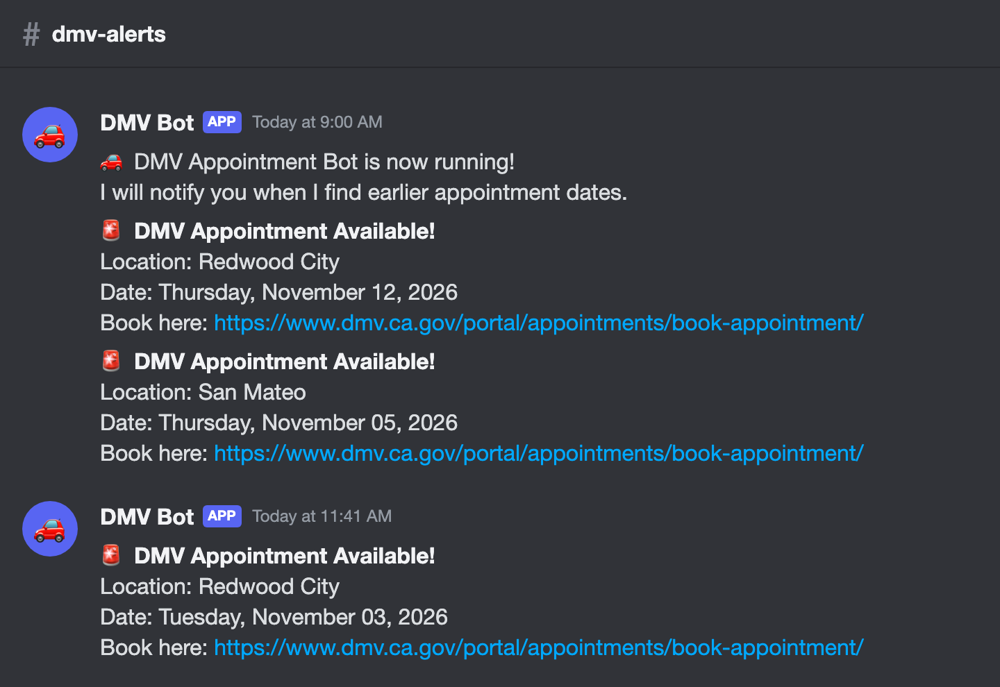

<div align="center">

<h1>DMV Notifier</h1>

<p><b>Earlier California DMV appointments, posted to Discord.</b></p>

<p><i>The next free DMV slot is weeks out, and cancellations that open earlier ones go to whoever happens to refresh the page.</i></p>

<h6>


</h6>

<a href="#how-it-works"><b>How it works</b></a> ·
<a href="#features"><b>Features</b></a> ·
<a href="#run-it"><b>Run it</b></a> ·
<a href="#deploy-it"><b>Deploy it</b></a>

<br><br>



<sub>Mock-up: the bot's exact message text, laid out the way Discord renders it, with made-up dates.</sub>

</div>

<br>

## Why

The California DMV's booking page shows the earliest open date per office, and it changes
whenever someone cancels. This script asks the same appointment API the booking page uses, on
a timer, and posts to a Discord channel when a date earlier than your cut-off appears. It is a
single Python file with no database, small enough to leave running on a free container host.

## How it works

<table>
<tr>
<td width="33%" valign="top">

**1 · Poll**

Every `LOOKUP_INTERVAL_SEC` (10 minutes by default, plus up to 30 seconds of jitter), it asks
the DMV for the open dates at each office.

</td>
<td width="33%" valign="top">

**2 · Compare**

It keeps the earliest date it has seen per office and ignores anything after
`FIND_DATES_BEFORE`.

</td>
<td width="33%" valign="top">

**3 · Post**

A new, earlier date goes to your Discord webhook with the office, the day and the booking link.

</td>
</tr>
</table>

## Features

- **Only real improvements.** After the first run it posts only when an office's earliest date moves earlier, so the channel stays quiet otherwise.
- **Two offices to start.** Redwood City and San Mateo are configured for one appointment type; other offices and services are entries in `branch_codes` and `dates_querystring`.
- **Backs off on errors.** Failed requests retry three times, then that office waits 5, 10, 20 minutes and up to an hour before trying again.
- **Tells you when it breaks.** An unexpected error in the main loop is posted to the channel as a code block, then the loop resumes after a minute.
- **No Discord bot account.** It posts through a channel webhook, so there is no token, gateway or permissions to set up.

## Run it

```bash
git clone https://github.com/parthchandak02/dmv-notifier-discord.git
cd dmv-notifier-discord
python3 -m venv venv && source venv/bin/activate
pip install -r requirements.txt
```

Create a `.env` next to `discord_bot.py`:

```bash
DISCORD_WEBHOOK_URL=        # Channel settings > Integrations > Webhooks > Copy URL
FIND_DATES_BEFORE=2026-12-31  # only alert for dates before this
LOOKUP_INTERVAL_SEC=600
```

```bash
python discord_bot.py
```

Set `FIND_DATES_BEFORE` yourself: the built-in default is a date in February 2025, which
nothing will ever beat now. The office IDs and the service ID are copied from the DMV site and
may have changed since this was last run in early 2025.

## Deploy it

The repo includes a `Dockerfile` and a `Procfile` (`worker: python discord_bot.py`).

```bash
docker build -t dmv-bot .
docker run -d --env-file .env dmv-bot
```

On [Railway](https://railway.app), connect the repo and add the three variables above; it
builds from the Dockerfile.

<details>
<summary><b>Project layout</b></summary>

```
discord_bot.py     polling loop, DMV requests, Discord webhook posts
requirements.txt   pinned dependencies
Dockerfile         python:3.11-slim image that runs the bot
Procfile           worker process for Railway or Heroku-style hosts
```

</details>

<br>

<div align="center">
<sub>Built with Python and requests. Data from the California DMV appointment API; alerts via Discord webhooks.</sub>
</div>
